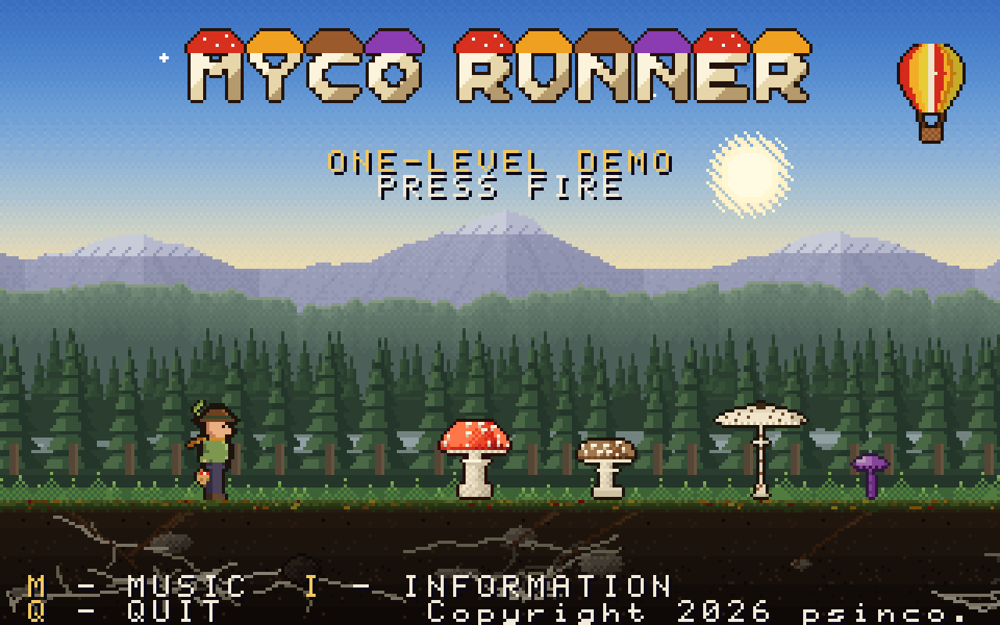
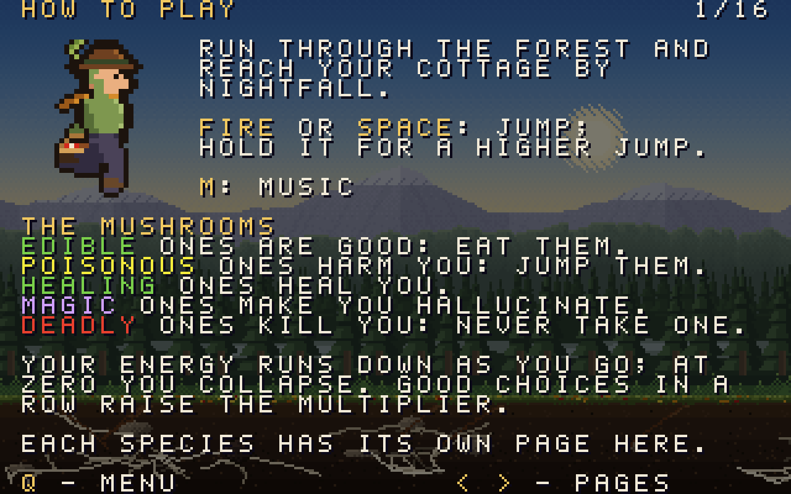
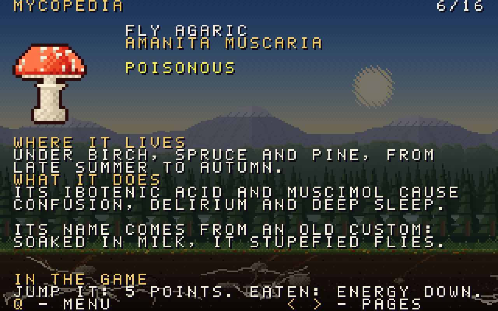
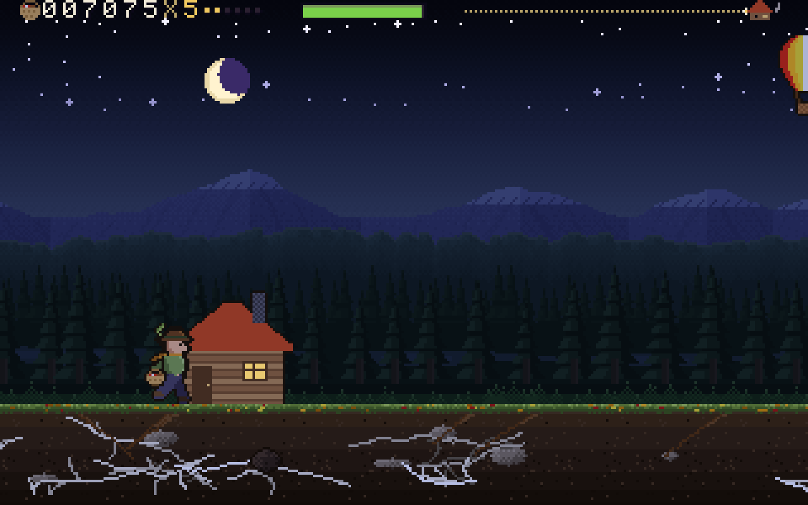

# Myco Runner

A runner game for the MEGA65. A mushroom picker runs through a forest from afternoon to
nightfall, to his cottage: eat the edible mushrooms, jump the poisonous ones, never take a deadly
one. Fourteen real European species, each with its page in the Mycopedia.

A one-level demo: one level, in any of 256 forests.

A 47-second video: [docs/myco-runner-promo.mp4](docs/myco-runner-promo.mp4). It is made on a PC
from the program's own output: every frame the engine builds, through a model of the VIC-IV, and
the SID registers it writes, through an emulation of the SID chip.

## Run

Needs a MEGA65 with its attic RAM, in PAL (50 Hz).

1. Download `MYCO-RUNNER.D81` from the [latest release](https://github.com/psincosoft/myco-runner/releases/latest)
   and copy it to the SD card.
2. `MOUNT "MYCO-RUNNER.D81"`
3. `LOAD"*",8,1`, then `RUN`

The opening card, the loading picture while the files load, then the title; I opens the
Mycopedia, whose first page says how to play.

## Controls

| Key | What it does |
|---|---|
| FIRE (either port) or SPACE | jump; hold for a higher jump, release early for a short hop |
| M | the music off and on (the sound effects stay) |
| I (on the title) | the Mycopedia: how to play, a page for each species, then the credits |
| CRSR left and right | turn the Mycopedia's pages |
| Q | back to the title (in a run, at its end, in the Mycopedia); on the title: the credits; on the credits: the end |
| FIRE on the end card | a new forest |
| hold FIRE on the end card (1 s) | the same forest again |

## How it plays

- **Edible** (penny bun, chanterelle, parasol, amethyst deceiver): points and a little energy. The
  penny bun and the chanterelle are prized: 25 points.
- **Poisonous** (fly agaric, panther cap, sulphur tuft): a red aura, 30 per cent of the energy
  gone, the multiplier back to 1. Leaving one standing scores 5, 15 more for a close jump.
- **Healing** (birch polypore, turkey tail): a green aura, a quarter of the energy back.
- **Magic** (liberty cap, Psilocybe serbica): a rainbow aura; the world slows to two thirds for the
  next four obstacles, the far landscape waves and shifts colour, the music drops a fifth.
- **Deadly** (death cap, destroying angel, fool's webcap): the end of the run. Leaving one standing
  scores 10, 30 more for a close jump.
- Energy drains slowly; at zero the picker collapses.
- Six correct reads in a row raise the multiplier (up to x5); leaving a good mushroom lowers it.
- Five alike in a ring: all eaten +100, all poisonous left standing +50.
- Distance scores a point every 28 pixels; reaching home +1,000 and 10 per energy point.
- The first time you meet a species, its name and Latin name show; the end card tells its fact.
- A death or a collapse leaves the scene grey, but the deadly mushroom keeps its colours, so that
  it is recognised; the end card shows over it (home: over the night).

## How it works

BASIC 65 shows the opening card, then the loading picture (MYCO.PIC: a picture and a small
program of its own, in bank 4) while it loads the engine into bank 5 and the pictures and the
forests into attic RAM; it fades the picture and calls the engine once; the engine runs the session
(title, runs, end sequences, end cards, the Mycopedia, the credits) until Q on the credits.

- **Screen**: VIC-IV raster rewrite buffer, 100 tokens a row, double-buffered; five parallax
  layers (sky, mountains and hills and forest in 4-bit characters, the soil full-colour) moved by
  GOTOX; every object (mushrooms, the picker, the aura, the popups, the sun and the moon, the
  balloon, the cottage, the logo) a run of characters placed by GOTOX, with a Y offset for those
  that move up and down.
- **Layouts**: the play's; the title's (its texts over the forest and the soil); the end card's
  (the run's last scene, copied run by run from the last frame, with the text beside the body);
  the Mycopedia's (the scene, a picture twice the size, the text: 16 pages).
- **Palette**: four times of day blended in 96 steps by distance; slow motion, poison, the end's
  grey and the pages' dimming are computed on it every frame.
- **Engine**: 6502 code with a few 45GS02 instructions, 7.8 KB resident plus a 4 KB overlay per
  mode (title, play, end sequence, end card, Mycopedia) loaded by DMA from attic RAM; the hardware
  multiplier; DMA for the layers, the animation frames, the pages and the screen.
- **Sound**: one tune in a day and a night mood: melody, bass, a ska guitar (stabs on the
  off-beats) and a reggae guitar (a tremolo on beats 2 and 4). Melody and bass sound on SIDs 1 and
  3, the fifteen effects on SIDs 2 and 4, so they sit in the middle of the stereo mix; the ska
  guitar is on SID 1 (a little right), the reggae guitar on SID 3 (a little left). M sets the
  tune's volume to 0 and back.

## Tested on

A MEGA65 (R6A) in PAL, core 890-sdcard-native build #63 (commit 1c737937), ROM 920422.

## Credits

Myco Runner, 2026, by Dawid Blachowski, with Claude, Anthropic's AI.
psinco. A Software Atelier from Luxembourg.

- Written with Claude, Anthropic's AI, which wrote the code, the pictures' programs and the music
  under Dawid Blachowski's direction.
- The pictures, the music and the sound effects are made by programs written for this game; no
  photograph, sample or existing tune is used. The font is our own.
- The fourteen species are real European mushrooms; the facts on the end cards and in the
  Mycopedia come from published sources. The file CREDITS on the disk has the details.
- Made with Python, NumPy, Pillow, py65 and d64; the video with FFmpeg and reSIDfp.

## Terms

Myco Runner is free. You may download it, run it, show it, film it, and share the disk image
unchanged and free of charge. See [LICENSE](LICENSE).
